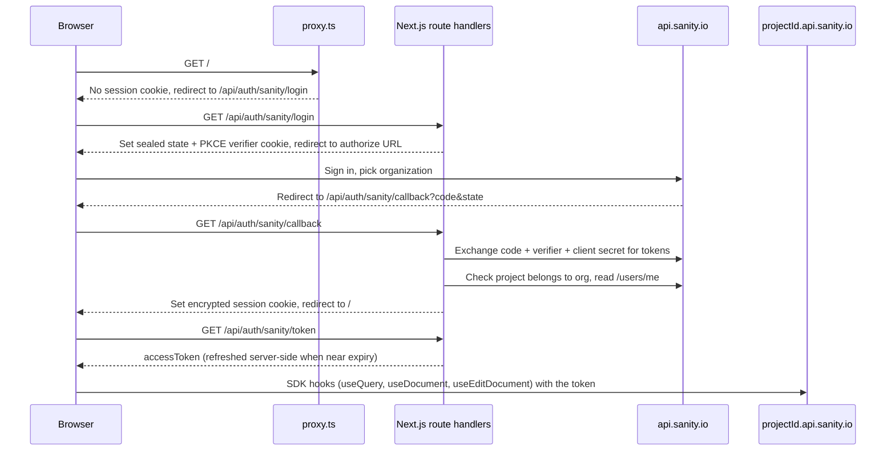

# Self-hosted Sanity App SDK app with Sanity OAuth

A [Next.js](https://nextjs.org) app that uses the [Sanity App SDK](https://www.sanity.io/docs/app-sdk) (`@sanity/sdk-react`) outside of the Sanity Dashboard. Users sign in with their own Sanity account through Sanity OAuth, so every read and write happens as that person. There's no shared robot token and nothing to paste.

The demo lists the 10 most recently updated documents in a dataset, lets you edit a document's `title` with `useEditDocument`, and includes an embedded Studio at `/studio`.

## How it works

The Next.js server is a confidential OAuth client. It runs the authorization code flow with PKCE, keeps the access and refresh tokens in an encrypted httpOnly cookie, and hands the browser only a short-lived access token for the SDK.



The main pieces:

| Path | Role |
| --- | --- |
| [`lib/oauth.ts`](lib/oauth.ts) | PKCE, authorize URL, code exchange, refresh, revoke |
| [`lib/session.ts`](lib/session.ts) | Encrypted cookie session (iron-session) |
| [`lib/sanity-user.ts`](lib/sanity-user.ts) | Organization check and `/users/me` lookup |
| [`app/api/auth/sanity/*`](app/api/auth/sanity) | `login`, `callback`, `token` and `logout` routes |
| [`proxy.ts`](proxy.ts) | Sends visitors without a session to sign in |
| [`components/SanityProvider.tsx`](components/SanityProvider.tsx) | Starts `SDKProvider` and keeps its token current |

## Quick start

You need a Sanity project, and permission to create an OAuth client in the organization that owns it. See the [full guide](docs/nextjs-sanity-oauth-guide.md) for how to set that up.

```bash
cp .env.example .env.local   # then fill in the values
pnpm install
pnpm dev
```

Open [http://localhost:3000](http://localhost:3000). You'll be redirected to sign in with Sanity.

## Security model

- The OAuth client secret and the refresh token stay on the server. Server-only modules import `server-only`, so the build fails if a client component imports them.
- Tokens are never stored in `localStorage`. The session is an httpOnly, `SameSite=Lax` cookie, encrypted with `SESSION_SECRET`, and marked `Secure` in production.
- The callback verifies `state` with a constant-time comparison and uses PKCE (S256). The post-login `returnTo` only allows same-origin paths.
- Tokens are scoped to one organization with a resource indicator. A sign-in under the wrong organization is rejected and its tokens are revoked.

## Docs

- [From a new Next.js app to the SDK with Sanity OAuth](docs/nextjs-sanity-oauth-guide.md): a step-by-step guide, including deployment and known caveats.

## License

[MIT](LICENSE)
